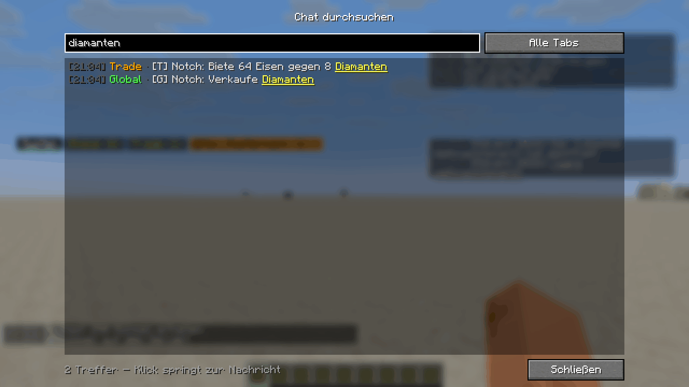

# Chat durchsuchen

🇬🇧 [English version](Searching-the-chat)

Im offenen Chat **Strg+F** drücken oder die **Lupe** ganz vorne in der Tab-Leiste anklicken.

- Gesucht wird im **ganzen gespeicherten Verlauf**, ohne Groß-/Kleinschreibung.
- **Mehrere Wörter** = alle müssen in der Nachricht vorkommen.
- **Suchen in:** *Alle Tabs* oder nur *Aktueller Tab*.
- Jeder Treffer zeigt Uhrzeit, Tab und Nachricht, der Suchbegriff ist gelb markiert.
- **Klick auf einen Treffer** öffnet den passenden Tab und scrollt so, dass die Nachricht in der Mitte steht. Sie wird ein paar Sekunden gelb hervorgehoben. Steht die Nachricht in einem [Chatfenster](Chatfenster-und-Filter), wird stattdessen dieses Fenster dorthin gescrollt.
- Bei mehr als 500 Treffern solltest du die Suche genauer eingrenzen.

Wie viele Nachrichten gespeichert werden, stellst du unter *Allgemein → Max. Verlauf* ein.
