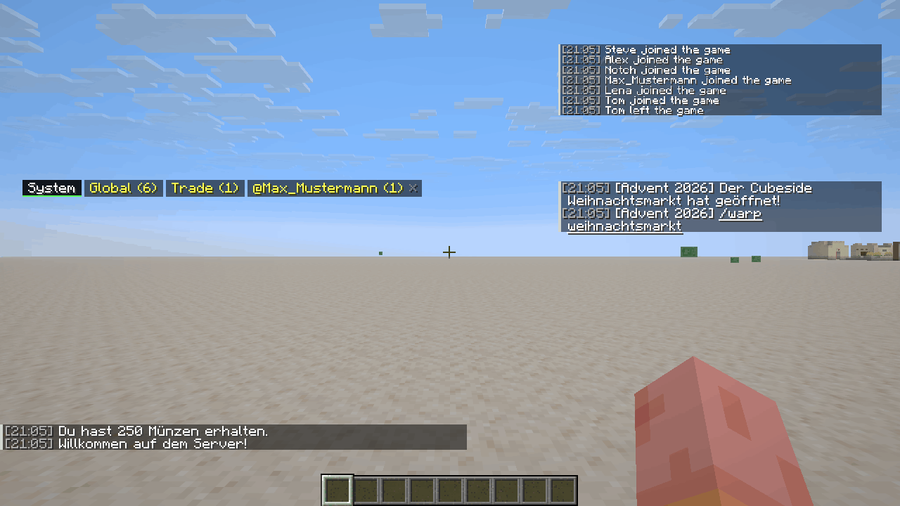
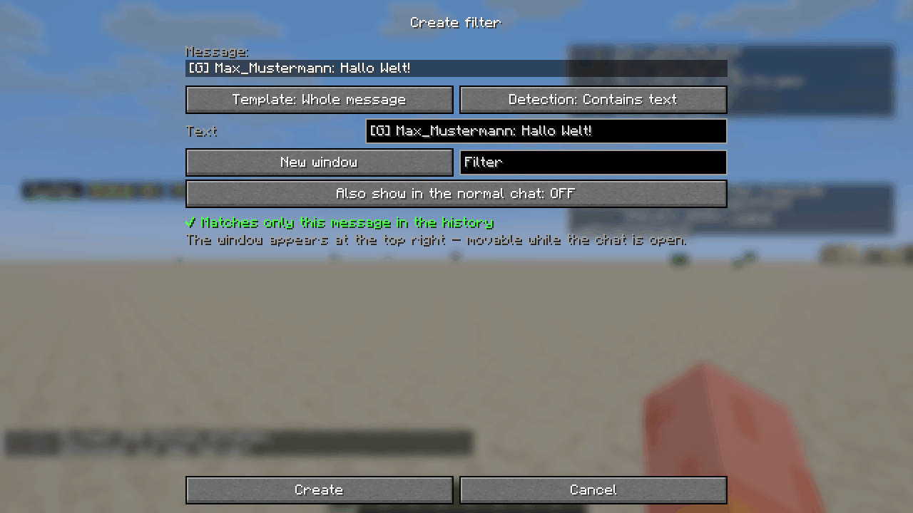
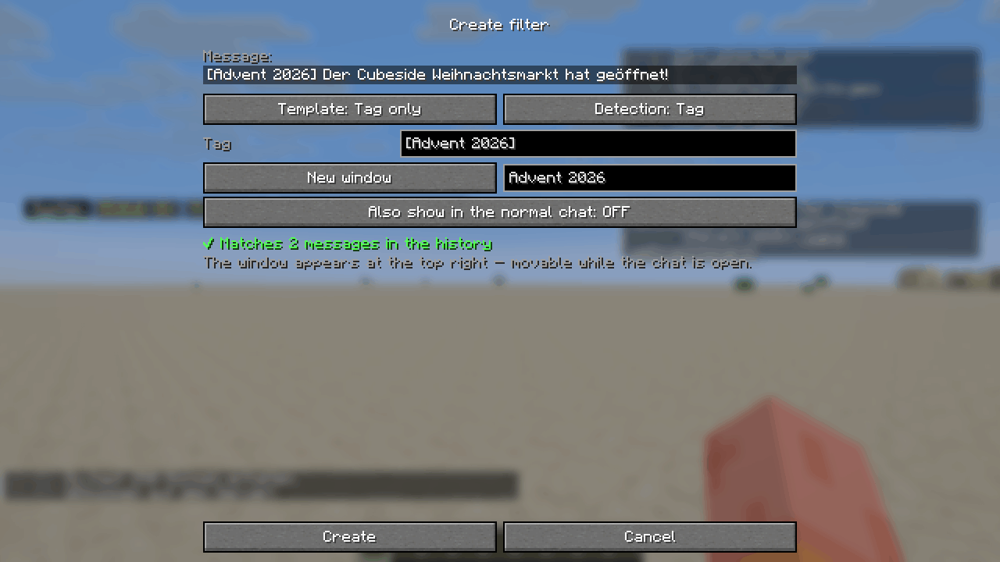
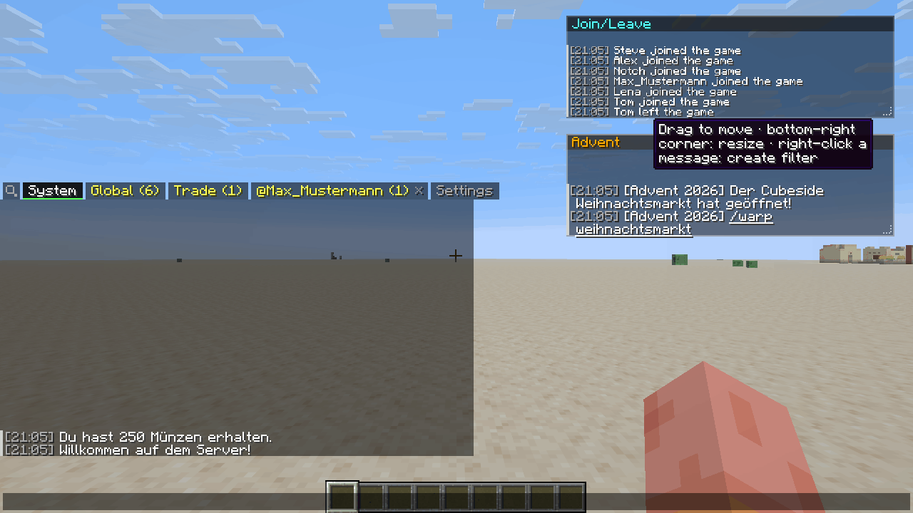
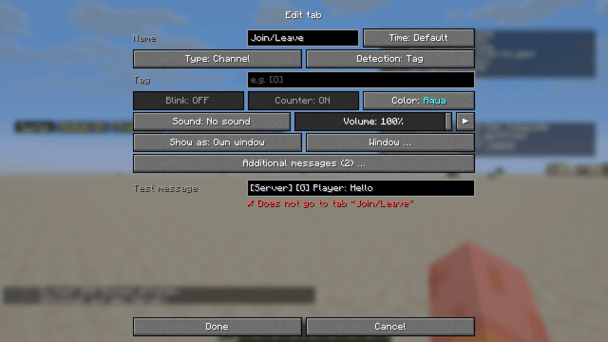
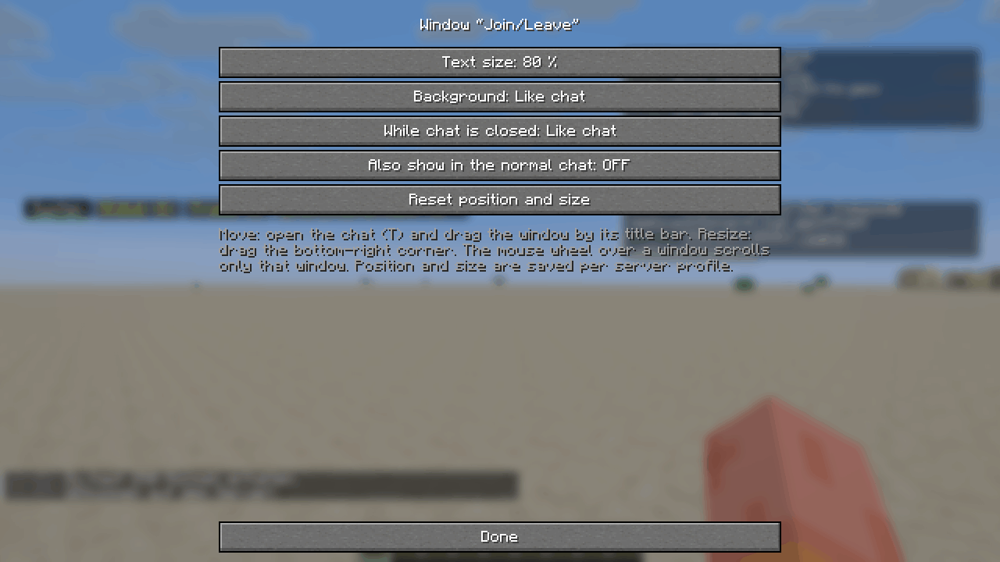

# Chat windows and filters

🇩🇪 [Deutsche Version](Chatfenster-und-Filter)

Besides tabs, ChatLanes can put messages into **separate chat windows**. A window is **always visible**, so you don't have to click a tab first. A typical example: join and leave messages in a small window at the top right, announcements like “[Advent 2026] Der Cubeside Weihnachtsmarkt hat geöffnet!” in a second one. This keeps the main chat tidy.

## Creating a filter with a right-click
The quickest way to get a window:

1. Open the chat (**T**).
2. **Right-click** a message. This works in the normal chat and in a window.
3. In the **Create filter** dialog choose what should happen and click **Create**.

| Setting | Meaning |
|---|---|
| **Template** | **Whole message**: exactly this message, e.g. only when Max_Mustermann writes “Hallo Welt!”. **Without sender**: this text, no matter who writes it. **Tag only**: everything starting with the same tag, e.g. `[Advent 2026]`. |
| **Detection** | *Contains text*, *Tag* or *Regex*. You can freely edit the text below. |
| **Target** | **New window**, **New tab** or an existing window or channel tab |
| **Name** | name of the new window or tab |
| **Also show in the normal chat** | **OFF**: the message is *moved* to the window. **ON**: it also appears where it would otherwise go (e.g. the Global or System tab). |

Below the buttons you immediately see **how many messages in the history already match** and whether the clicked message itself matches.

Example with the *Tag only* template:

### Window filters vs. tab filters
- **Window filters** apply to **every** message, including channel messages like `[G] Max: Hello` and private messages, and take **priority** over all tabs.
- **Tab filters** (like [Additional messages](Tabs-and-channels#additional-messages)) only apply to messages that would otherwise land in the System tab.

### Changing or deleting a filter
Settings (**K**) → **Edit** on the window → **Additional messages …**. All filters are listed there as rules and can be edited or deleted with **✕**.

## Moving and resizing windows
While the **chat is open**, every window gets a title bar:

- **Move:** drag the **title bar** (with the name).
- **Resize:** drag the **bottom-right corner** (small marker).
- **Scroll:** mouse wheel over the window. Hold Shift to scroll line by line.
- **Links and commands** in messages can be clicked like in the normal chat. Shift+click inserts text into the input field.

Position and size are saved automatically **per server profile** when you let go. They are stored relative to the screen size, so the window stays in the same place with a different window size or GUI scale.

## Turning a tab into a window
Every **Channel** and **All** tab can be a window:

1. Settings (**K**) → **Edit** on the tab.
2. Click **Show as: Tab bar** until it says **Own window**.
3. **Done** and **Save**.

The tab then disappears from the tab bar. Switch command, send prefix, blink and counter don't matter for windows, because you don't type into a window and it is always visible. Sounds still work.

> **Tip – the complete history:** A window of type **All** shows every message in its original order, exactly as it arrived. It's basically the normal Minecraft chat, so you can always check what was written when.

## Window settings
Click **Window …** in the tab editor:

| Setting | Values |
|---|---|
| **Text size** | *Like chat* (Minecraft's “Chat Text Size”) or 50 % to 150 % |
| **Background** | *Like chat* or 0 % to 100 % opacity (0 % = text only) |
| **While chat is closed** | *Like chat*: new messages appear and fade out like in the normal chat (see [Appearance](Settings#appearance)). *Always visible*: the latest messages stay on screen. *Only when chat is open*: the window stays hidden until you open the chat. Or a fixed time from 5 seconds to 5 minutes. |
| **Also show in the normal chat** | same as in the filter dialog (channel windows only) |
| **Reset position and size** | moves the window back to the top right in its default size |

You can create **as many windows as you like**.
