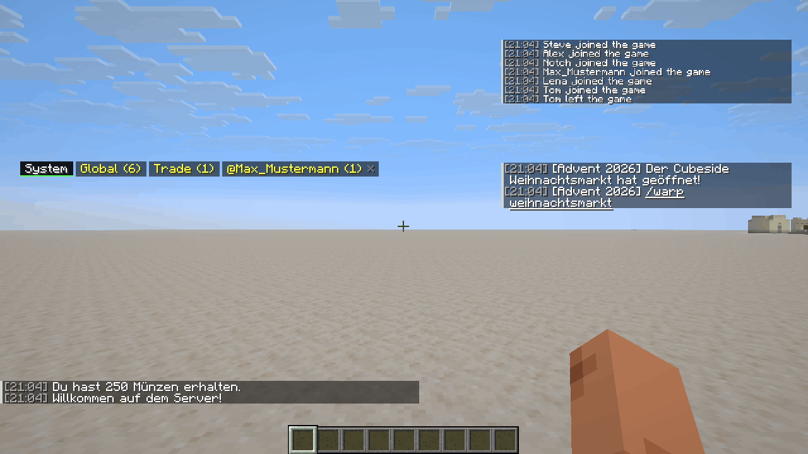
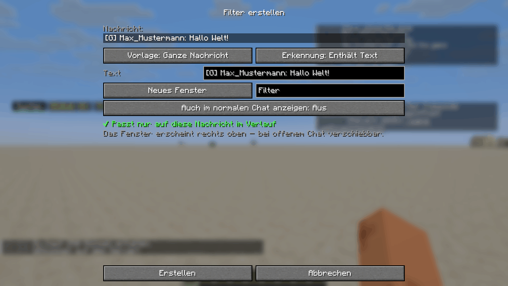
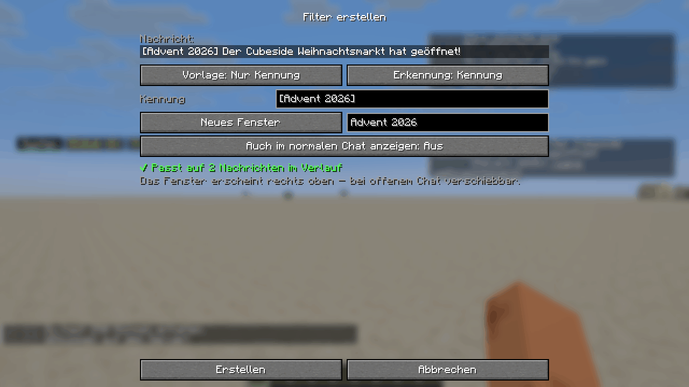
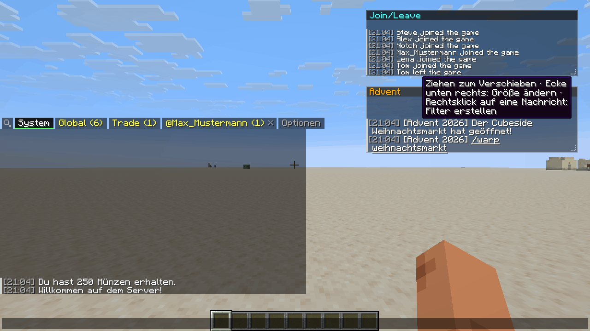
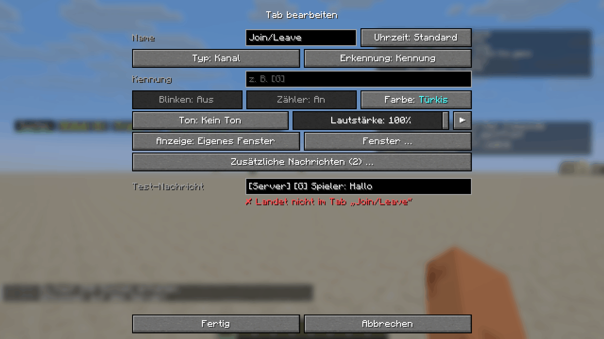
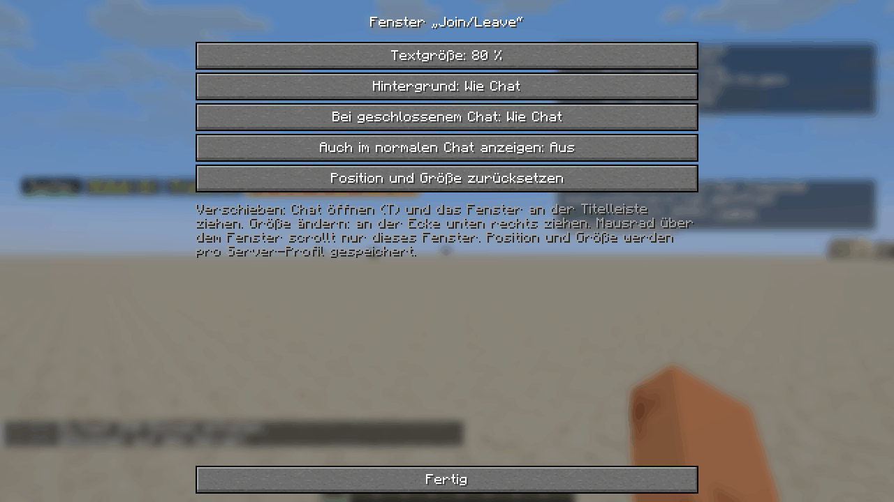

# Chatfenster und Filter

🇬🇧 [English version](Chat-windows-and-filters)

Neben den Tabs kann ChatLanes Nachrichten in **eigene Chatfenster** legen. Ein Fenster ist **ständig sichtbar**, du musst also nicht erst einen Tab anklicken. Ein typisches Beispiel: Join- und Leave-Nachrichten in ein kleines Fenster rechts oben, Ankündigungen wie „[Advent 2026] Der Cubeside Weihnachtsmarkt hat geöffnet!“ in ein zweites. Der Hauptchat bleibt dadurch übersichtlich.

## Filter per Rechtsklick erstellen
Der schnellste Weg zu einem Fenster:

1. Chat öffnen (**T**).
2. Mit **Rechtsklick** auf eine Nachricht klicken. Das geht im normalen Chat und in einem Fenster.
3. Im Dialog **Filter erstellen** auswählen, was passieren soll, und **Erstellen** klicken.

| Einstellung | Bedeutung |
|---|---|
| **Vorlage** | **Ganze Nachricht**: genau diese Nachricht, z. B. nur, wenn Max_Mustermann „Hallo Welt!“ schreibt. **Ohne Absender**: dieser Text, egal wer ihn schreibt. **Nur Kennung**: alles mit derselben Kennung am Anfang, z. B. `[Advent 2026]`. |
| **Erkennung** | *Enthält Text*, *Kennung* oder *Regex*. Den Text darunter kannst du frei anpassen. |
| **Ziel** | **Neues Fenster**, **Neuer Tab** oder ein bestehendes Fenster bzw. ein bestehender Kanal-Tab |
| **Name** | Name des neuen Fensters oder Tabs |
| **Auch im normalen Chat anzeigen** | **Aus**: die Nachricht wird ins Fenster *verschoben*. **An**: sie erscheint zusätzlich dort, wo sie sonst landen würde (z. B. im Global- oder System-Tab). |

Unter den Knöpfen siehst du sofort, **wie viele Nachrichten im Verlauf schon passen** und ob die angeklickte Nachricht selbst passt.

Beispiel mit der Vorlage *Nur Kennung*:

### Fenster-Filter und Tab-Filter
- **Filter von Fenstern** gelten für **jede** Nachricht, also auch für Kanal-Nachrichten wie `[G] Max: Hallo` oder private Nachrichten, und haben **Vorrang** vor allen Tabs.
- **Filter von Tabs** gelten (wie die [Zusätzlichen Nachrichten](Tabs-und-Kanaele#zusätzliche-nachrichten)) nur für Nachrichten, die sonst im System-Tab landen würden.

### Filter ändern oder löschen
Einstellungen (**K**) → beim Fenster **Bearbeiten** → **Zusätzliche Nachrichten …**. Dort stehen alle Filter als Regeln und lassen sich bearbeiten oder mit **✕** löschen.

## Fenster verschieben und Größe ändern
Bei **offenem Chat** bekommt jedes Fenster eine Titelleiste:

- **Verschieben:** an der **Titelleiste** (mit dem Namen) ziehen.
- **Größe ändern:** an der **Ecke unten rechts** (kleine Markierung) ziehen.
- **Scrollen:** Mausrad über dem Fenster. Mit gedrückter Umschalttaste scrollst du zeilenweise.
- **Links und Befehle** in Nachrichten lassen sich anklicken wie im normalen Chat. Mit Umschalt+Klick fügst du Text in das Eingabefeld ein.

Position und Größe werden beim Loslassen automatisch **pro Server-Profil** gespeichert. Sie werden relativ zur Bildschirmgröße gespeichert, damit das Fenster auch bei anderer Fenstergröße oder GUI-Skalierung an derselben Stelle sitzt.

## Einen Tab zum Fenster machen
Jeder **Kanal**- und **Alle**-Tab kann ein Fenster sein:

1. Einstellungen (**K**) → beim Tab **Bearbeiten**.
2. **Anzeige: Tab-Leiste** anklicken, bis **Eigenes Fenster** dasteht.
3. **Fertig** und **Speichern**.

Der Tab verschwindet dann aus der Tab-Leiste. Wechsel-Befehl, Sende-Präfix, Blinken und Zähler spielen bei Fenstern keine Rolle, weil du in einem Fenster nicht schreibst und es immer sichtbar ist. Der Ton funktioniert weiterhin.

> **Tipp – der komplette Verlauf:** Ein Fenster vom Typ **Alle** zeigt jede Nachricht in der Original-Reihenfolge, so wie sie angekommen ist. Das ist praktisch der normale Minecraft-Chat, mit dem du jederzeit nachkontrollieren kannst, was wann geschrieben wurde.

## Fenster-Einstellungen
Im Tab-Editor auf **Fenster …** klicken:

| Einstellung | Werte |
|---|---|
| **Textgröße** | *Wie Chat* (Minecraft-Einstellung „Chat-Textgröße“) oder 50 % bis 150 % |
| **Hintergrund** | *Wie Chat* oder 0 % bis 100 % Deckkraft (0 % = nur Text) |
| **Bei geschlossenem Chat** | *Wie Chat*: neue Nachrichten erscheinen und blenden aus wie im normalen Chat (siehe [Aussehen](Einstellungen#aussehen)). *Immer sichtbar*: die letzten Nachrichten bleiben stehen. *Nur bei offenem Chat*: das Fenster ist versteckt, bis du den Chat öffnest. Oder eine feste Zeit von 5 Sekunden bis 5 Minuten. |
| **Auch im normalen Chat anzeigen** | wie beim Filter-Dialog (nur bei Kanal-Fenstern) |
| **Position und Größe zurücksetzen** | setzt das Fenster wieder rechts oben in Standardgröße |

Du kannst **beliebig viele Fenster** anlegen.
