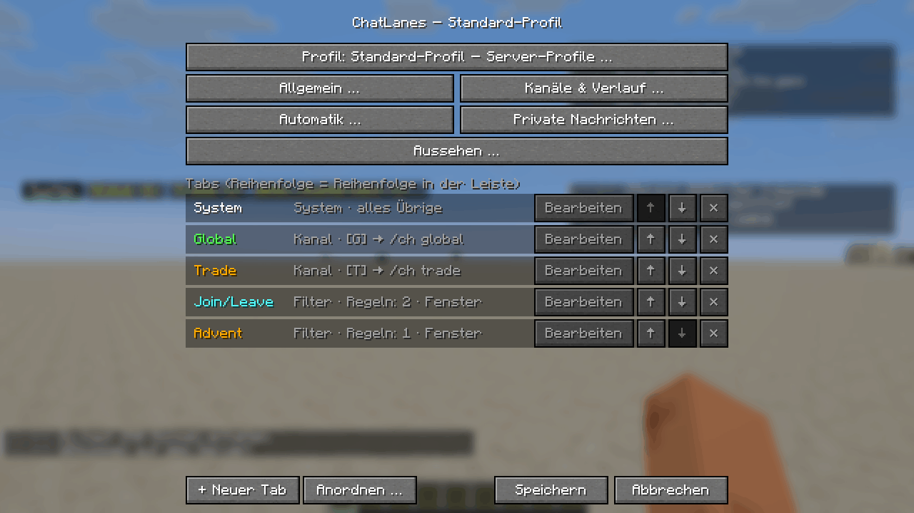
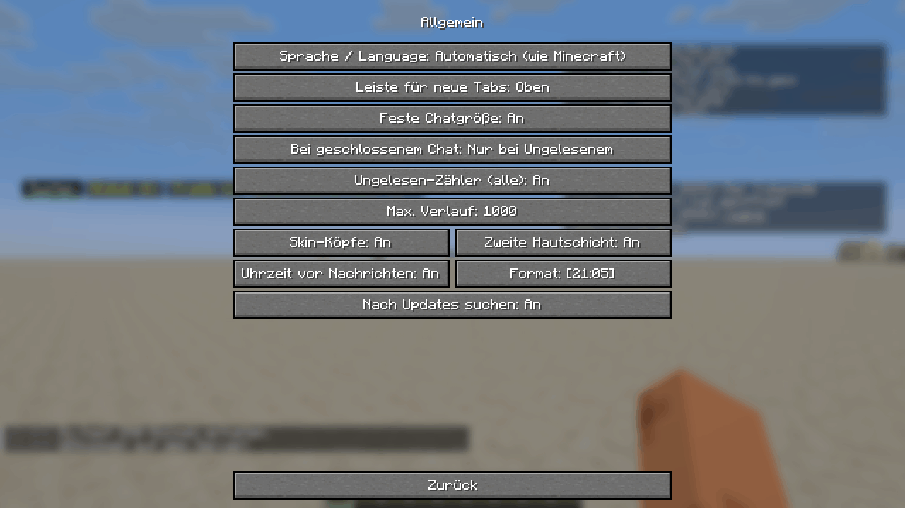
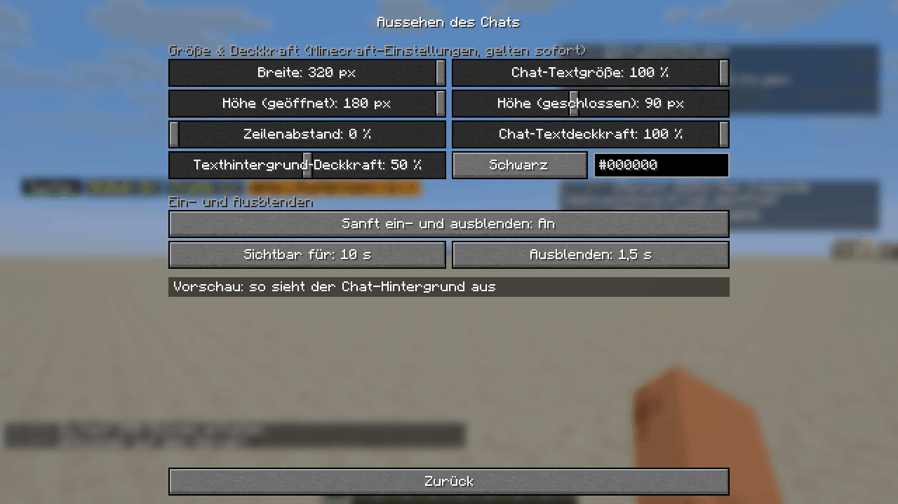
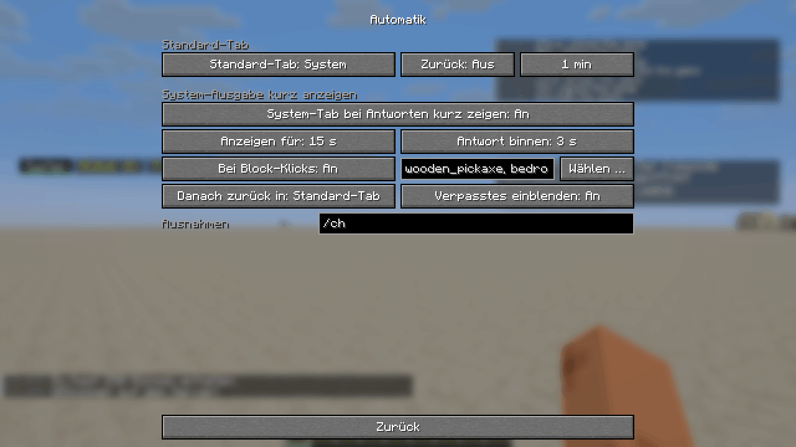
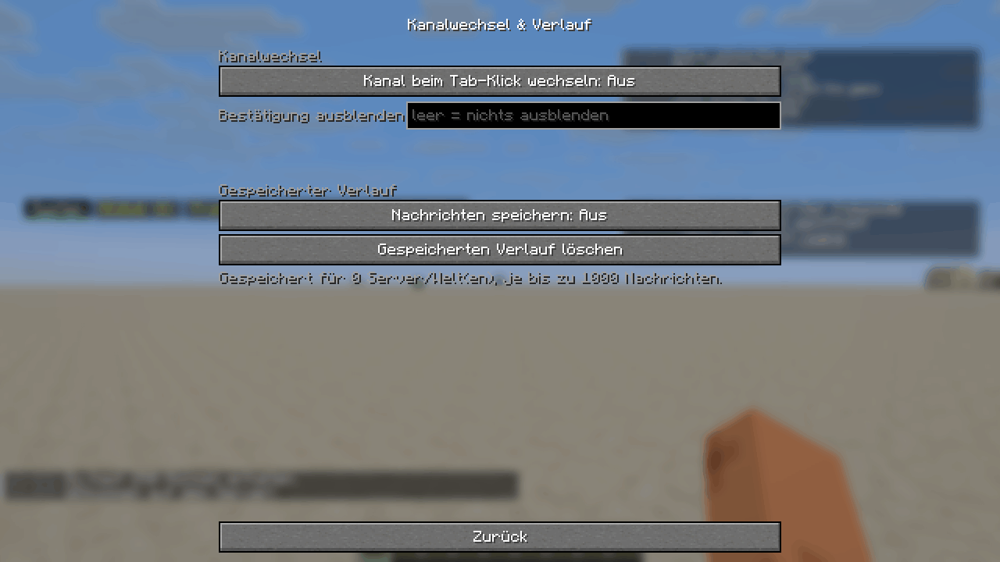

# Einstellungen

🇬🇧 [English version](Settings)

Öffnen mit Taste **K**, `/chatlanes`, **„Optionen“** in der Tab-Leiste oder über Mod Menu. Alle Einstellungen gelten für das **aktuelle Server-Profil** (siehe [Server-Profile](Server-Profile)) und werden erst mit **Speichern** übernommen.

Die Tab-Liste und der Tab-Editor sind auf der Seite [Tabs und Kanäle](Tabs-und-Kanaele) erklärt, die Fenster auf [Chatfenster und Filter](Chatfenster-und-Filter) und die Msg-Tabs auf [Private Nachrichten](Private-Nachrichten).

## Allgemein

| Einstellung | Bedeutung |
|---|---|
| **Sprache / Language** | *Automatisch* (wie Minecraft), *Deutsch* oder *English*. Gilt für alle Profile. |
| **Leiste für neue Tabs** | ob neue Tabs in der oberen oder unteren Leiste landen |
| **Feste Chatgröße** | bei offenem Chat hat das Chatfeld immer die volle Höhe, damit die Tabs immer an derselben Stelle sitzen |
| **Bei geschlossenem Chat** | ob die Tab-Leiste bei geschlossenem Chat *immer*, *nur bei Ungelesenem* oder *gar nicht* angezeigt wird (pro Leiste einstellbar unter *Anordnen*) |
| **Ungelesen-Zähler (alle)** | Hauptschalter für `(3)` hinter den Tab-Namen (pro Tab unter *Bearbeiten → Zähler*) |
| **Max. Verlauf** | wie viele Nachrichten insgesamt gespeichert werden (Vanilla: 100). Alle Tabs teilen sich diesen Speicher. |
| **Skin-Köpfe** | Skin-Kopf vor dem Spielernamen. Erkannt werden Spieler, die online sind (oder es in dieser Sitzung waren), sowie private Nachrichten. |
| **Zweite Hautschicht** | Kopf mit Hut-/Helm-Schicht des Skins |
| **Uhrzeit vor Nachrichten** | z. B. `[14:05] [G] Spieler: Hi`. Gilt für alle Tabs mit *Uhrzeit: Standard*. |
| **Format** | `[14:05]`, `[14:05:33]`, `14:05` oder `14:05:33` |
| **Nach Updates suchen** | meldet sich im Chat, wenn es auf GitHub eine neuere Version gibt. Gilt für alle Profile. |

## Aussehen

**Größe & Deckkraft:** Breite, Höhe (geöffnet), Höhe (geschlossen), Chat-Textgröße, Zeilenabstand, Chat-Textdeckkraft und Text-Hintergrunddeckkraft. Das sind die normalen Minecraft-Einstellungen, hier direkt im Menü, und sie gelten sofort.

**Hintergrund:** Farbe des Chat-Hintergrunds, wählbar aus Vorgaben (Schwarz, Grau, Blau, Grün, Lila, Rot, Braun, Türkis) oder als eigener Hex-Wert wie `#1E3A5F`. Die Deckkraft kommt aus „Text-Hintergrunddeckkraft“. Unten siehst du eine Vorschau.

**Ein- und Ausblenden:**
- **Sanft ein- und ausblenden:** neue Nachrichten blenden weich ein und verschwinden bei geschlossenem Chat langsam statt abrupt.
- **Sichtbar für:** wie lange Nachrichten bei geschlossenem Chat stehen bleiben.
- **Ausblenden:** wie lange das Ausblenden dauert.

## Automatik

### Standard-Tab
- **Standard-Tab:** dieser Tab ist bei jedem Spielstart ausgewählt. Schreibst du nach dem Login dort, wechselt die Mod vorher automatisch in dessen Kanal.
- **Zurück / Nach:** wechselt automatisch zurück in den Standard-Tab, wenn du so lange im aktuellen Tab nichts geschrieben hast. Das passiert erst bei geschlossenem Chat, damit dir beim Lesen nichts wegspringt.

### System-Ausgabe kurz anzeigen
Kommt kurz nach einem Befehl oder Block-Klick etwas in den System-Tab, springt die Ansicht dorthin und danach wieder zurück. Der Kanal auf dem Server bleibt dabei unverändert. Praktisch z. B. für LogBlock-Abfragen.

| Einstellung | Bedeutung |
|---|---|
| **System-Tab bei Antworten kurz zeigen** | Funktion an oder aus |
| **Anzeigen für** | wie lange die Ansicht im System-Tab bleibt. Weitere Antworten verlängern die Zeit. |
| **Antwort binnen** | nur System-Nachrichten, die so kurz nach deiner Aktion kommen, lösen das Anzeigen aus |
| **Bei Block-Klicks** | auch Klicks auf Blöcke zählen als Aktion |
| **Items / Wählen …** | nur mit diesen Items in der Hand zählen Block-Klicks (z. B. `wooden_pickaxe, bedrock`). *Wählen …* öffnet eine Liste aller Items zum Anklicken. Leer = jedes Item. |
| **Danach zurück in** | *Standard-Tab* oder *vorherigen Tab* |
| **Verpasstes einblenden** | nach dem Zurückspringen werden die Nachrichten, die in der Zwischenzeit im Tab angekommen sind, noch einmal eingeblendet |
| **Ausnahmen** | Befehle, die nie in den System-Tab springen, z. B. `/ch`. Die Wechsel-Befehle deiner Tabs und private Nachrichten sind automatisch ausgenommen. |

## Kanäle & Verlauf

| Einstellung | Bedeutung |
|---|---|
| **Kanal beim Tab-Klick wechseln** | beim Auswählen eines Tabs dessen Wechsel-Befehl (z. B. `/ch global`) an den Server senden |
| **Bestätigung ausblenden** | optionaler regulärer Ausdruck für die Server-Antwort auf den Kanalwechsel (z. B. `^Du schreibst jetzt in`). Passende Nachrichten bis 3 Sekunden nach einem Tab-Wechsel werden nicht angezeigt. |
| **Nachrichten speichern** | speichert die Nachrichten aller Tabs pro Server und lädt sie beim nächsten Betreten wieder in die richtigen Tabs. Eine Trennlinie zeigt, wo der gespeicherte Verlauf endet. |
| **Gespeicherten Verlauf löschen** | löscht die gespeicherten Nachrichten aller Server (zweimal klicken). Der aktuell sichtbare Chat bleibt erhalten. |

> Speichert eine andere Mod ebenfalls Chat-Nachrichten, erscheinen alte Nachrichten doppelt. Schalte dann eine der beiden Funktionen aus.
