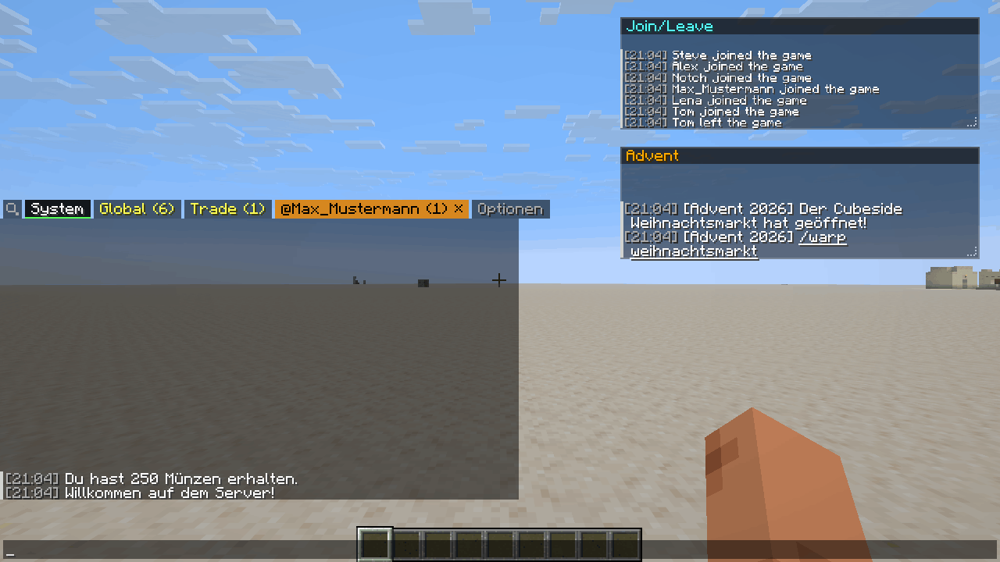

# ChatLanes

**ChatLanes** ist eine Fabric-Mod für Minecraft 26.3, die den Chat in **Tabs** und frei verschiebbare **Chatfenster** aufteilt.
*ChatLanes is a Fabric mod for Minecraft 26.3 that splits the chat into **tabs** and freely movable **chat windows**.*

| 🇩🇪 Deutsch | 🇬🇧 English |
|---|---|
| [Installation](Installation) | [Installation](Installation-EN) |
| [Tabs und Kanäle](Tabs-und-Kanaele) | [Tabs and channels](Tabs-and-channels) |
| [Chatfenster und Filter](Chatfenster-und-Filter) | [Chat windows and filters](Chat-windows-and-filters) |
| [Private Nachrichten](Private-Nachrichten) | [Private messages](Private-messages) |
| [Chat durchsuchen](Chat-durchsuchen) | [Searching the chat](Searching-the-chat) |
| [Einstellungen](Einstellungen) | [Settings](Settings) |
| [Server-Profile](Server-Profile) | [Server profiles](Server-profiles) |
| [Häufige Fragen](Haeufige-Fragen) | [FAQ](FAQ) |

**Download:** [Releases](https://github.com/0eiki0/chatlanes/releases) · **Quellcode / Source:** [github.com/0eiki0/chatlanes](https://github.com/0eiki0/chatlanes)
