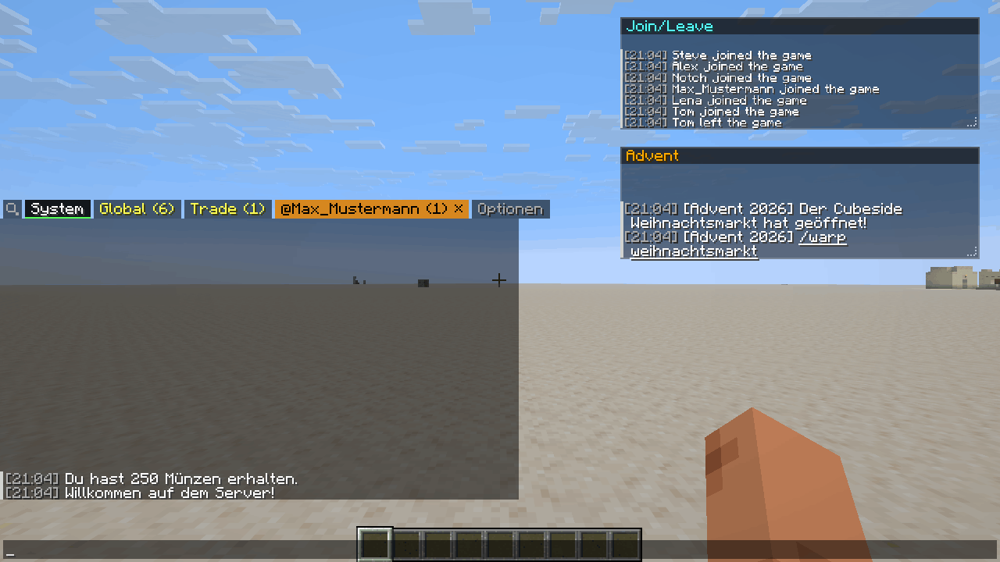
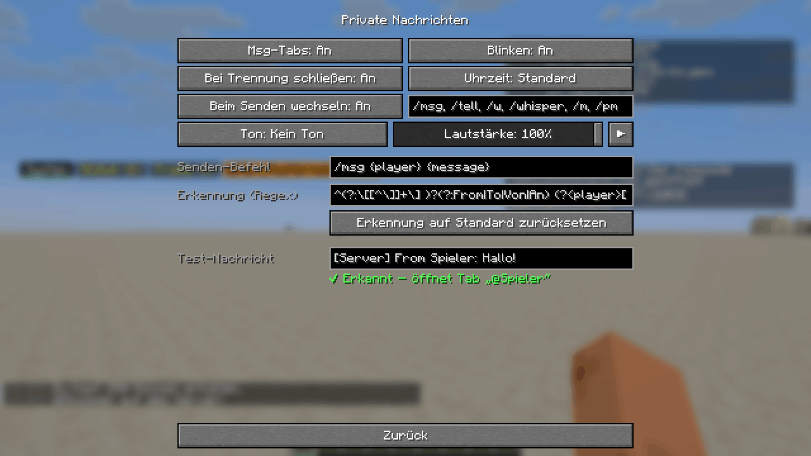

# Private Nachrichten

🇬🇧 [English version](Private-messages)

Für jeden Spieler, der dir privat schreibt (oder dem du schreibst), legt ChatLanes automatisch einen eigenen Tab **@Name** an.

## Bedienung
- Msg-Tabs mit ungelesenen Nachrichten **blinken**.
- **Schließen:** mit dem **×** am Tab oder per Rechts- oder Mittelklick. Ein geschlossener Tab bleibt auch nach einem Neustart zu, bis der Spieler dir wieder schreibt.
- **Schreiben im Msg-Tab:** Was du dort tippst, wird automatisch als `/msg <Spieler> <Text>` gesendet. Befehle mit `/` bleiben unverändert.
- **Automatisch wechseln:** Schickst du selbst `/msg Name …` (auch `/tell`, `/w`, `/r` usw.), wechselt die Mod in den Tab `@Name` und legt ihn bei Bedarf an. Bei `/r` geht es in den Tab des letzten Gesprächspartners.

## Einstellungen
Einstellungen (**K**) → **Private Nachrichten …**

| Einstellung | Bedeutung |
|---|---|
| **Msg-Tabs** | Msg-Tabs an oder aus |
| **Blinken** | Msg-Tabs mit ungelesenen Nachrichten blinken |
| **Bei Trennung schließen** | schließt alle Msg-Tabs, wenn du den Server verlässt |
| **Uhrzeit** | Uhrzeit vor privaten Nachrichten (Standard/An/Aus) |
| **Beim Senden wechseln** | beim eigenen `/msg` in den passenden Tab wechseln |
| **Msg-Befehle** | Befehle für private Nachrichten auf deinem Server, das erste Wort danach ist der Spielername. Standard: `/msg, /tell, /w, /whisper, /m, /pm` |
| **Ton / Lautstärke** | Ton bei neuen privaten Nachrichten |
| **Senden-Befehl** | was beim Schreiben im Msg-Tab gesendet wird. `{player}` = Spieler, `{message}` = deine Nachricht. Standard: `/msg {player} {message}` |
| **Erkennung (Regex)** | erkennt private Nachrichten. Der Spielername steht in der Gruppe `(?<player>…)`, weitere Alternativen in `(?<player2>…)`, `(?<player3>…)` usw. |
| **Erkennung auf Standard zurücksetzen** | stellt den mitgelieferten Ausdruck wieder her |
| **Test-Nachricht** | Live-Test: zeigt, ob eine Zeile erkannt wird und welcher Tab sich öffnen würde |

Der Standard erkennt z. B. `From Name: …`, `Von Name: …`, `[Name -> mir] …` und `[mir -> Name] …`.
