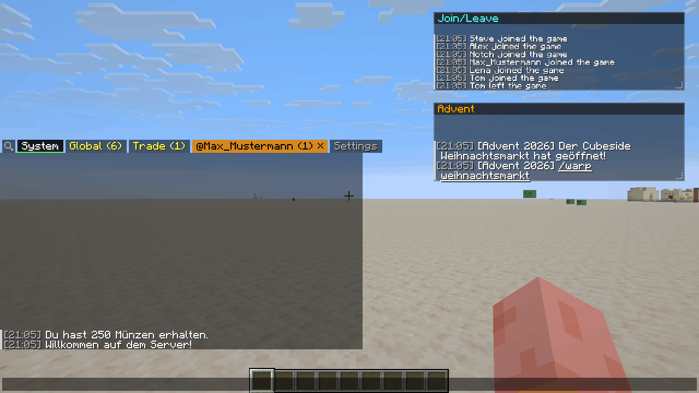
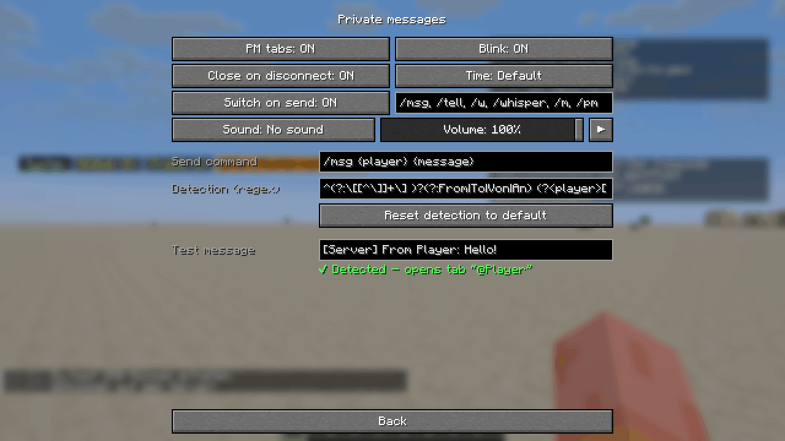

# Private messages

🇩🇪 [Deutsche Version](Private-Nachrichten)

For every player who messages you privately (or whom you message), ChatLanes automatically creates a separate tab **@Name**.

## Usage
- PM tabs with unread messages **blink**.
- **Close:** with the **×** on the tab, or by right- or middle-clicking it. A closed tab stays closed even after a restart, until the player writes to you again.
- **Writing in a PM tab:** whatever you type there is sent as `/msg <player> <text>` automatically. Commands starting with `/` are not changed.
- **Automatic switching:** if you send `/msg Name …` yourself (also `/tell`, `/w`, `/r` etc.), the mod switches to the `@Name` tab and creates it if needed. With `/r` it goes to the tab of your last conversation partner.

## Settings
Settings (**K**) → **Private messages …**

| Setting | Meaning |
|---|---|
| **PM tabs** | PM tabs on or off |
| **Blink** | PM tabs with unread messages blink |
| **Close on disconnect** | closes all PM tabs when you leave the server |
| **Time** | time in front of private messages (Default/ON/OFF) |
| **Switch on send** | switch to the matching tab when you send `/msg` yourself |
| **PM commands** | private message commands on your server, the first word after them is the player name. Default: `/msg, /tell, /w, /whisper, /m, /pm` |
| **Sound / Volume** | sound for new private messages |
| **Send command** | what is sent when you type in a PM tab. `{player}` = player, `{message}` = your message. Default: `/msg {player} {message}` |
| **Detection (regex)** | recognizes private messages. The player name is in the group `(?<player>…)`, further alternatives in `(?<player2>…)`, `(?<player3>…)` etc. |
| **Reset detection to default** | restores the built-in expression |
| **Test message** | live test: shows whether a line is recognized and which tab would open |

The default recognizes e.g. `From Name: …`, `Von Name: …`, `[Name -> me] …` and `[me -> Name] …`.
