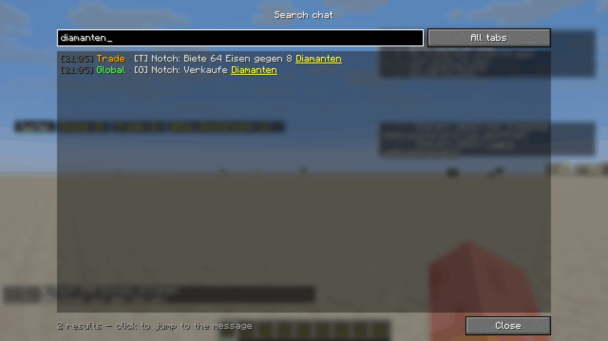

# Searching the chat

🇩🇪 [Deutsche Version](Chat-durchsuchen)

Press **Ctrl+F** in the open chat or click the **magnifier** at the front of the tab bar.

- Searches the **whole saved history**, case-insensitive.
- **Several words** = all of them must appear in the message.
- **Search in:** *All tabs* or only the *Current tab*.
- Every result shows the time, the tab and the message, with the search term highlighted in yellow.
- **Clicking a result** opens the matching tab and scrolls so the message is in the middle. It is highlighted in yellow for a few seconds. If the message is in a [chat window](Chat-windows-and-filters), that window is scrolled there instead.
- With more than 500 results you should narrow your search.

How many messages are kept is set under *General → Max history*.
