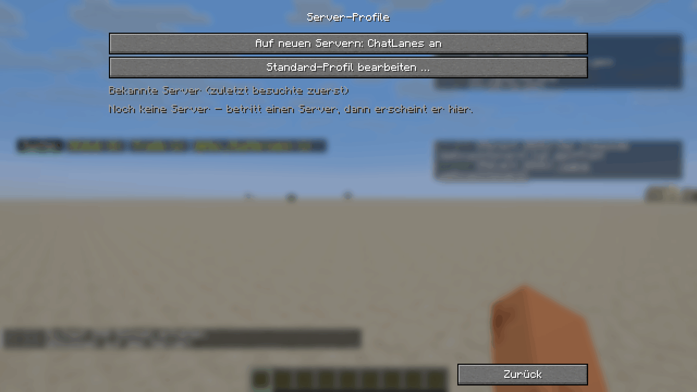

# Server-Profile

🇬🇧 [English version](Server-profiles)

Jeder Server bekommt beim ersten Betreten automatisch ein **eigenes Profil** mit eigenen Tabs, Fenstern und Einstellungen. Das Profil ist eine Kopie des **Standard-Profils**. Das Standard-Profil gilt im Einzelspieler und ist die Vorlage für neue Server.

Öffnen: Einstellungen (**K**) → ganz oben **Profil: … – Server-Profile …**

| Einstellung | Bedeutung |
|---|---|
| **Auf neuen Servern** | ob ChatLanes auf einem Server, den du zum ersten Mal betrittst, *an* oder *aus* ist. Aus = der Chat sieht aus wie in normalem Minecraft. Ein Profil bekommt der Server trotzdem. |
| **Standard-Profil bearbeiten …** | Vorlage für neue Server und Profil für den Einzelspieler |
| **Liste der Server** | alle bekannten Server, zuletzt besuchte zuerst |
| **ChatLanes an/aus** | pro Server ein- oder ausschalten |
| **Profil …** | das Profil dieses Servers bearbeiten |
| **↺** | Profil durch eine Kopie des Standard-Profils ersetzen (zweimal klicken) |
| **✕** | Server aus der Liste entfernen und sein Profil löschen (zweimal klicken; der aktuelle Server kann nicht entfernt werden) |

**Sprache** und **Update-Prüfung** gelten für alle Profile gemeinsam. Auch die **Position und Größe der Chatfenster** werden pro Profil gespeichert.

Gespeichert wird in `config/chatlanes/servers.json` und `config/chatlanes/profiles/`.
