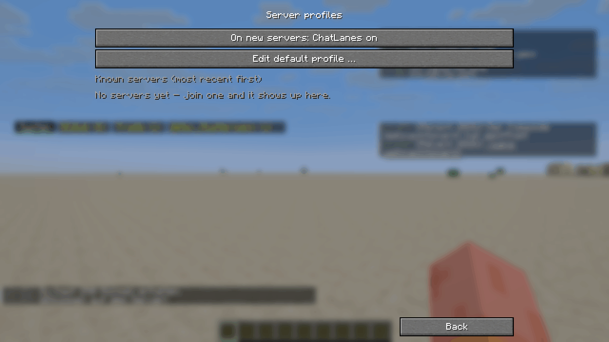

# Server profiles

🇩🇪 [Deutsche Version](Server-Profile)

Every server automatically gets its **own profile** with its own tabs, windows and settings the first time you join. The profile is a copy of the **default profile**. The default profile is used in singleplayer and is the template for new servers.

Open: Settings (**K**) → at the very top **Profile: … – Server profiles …**

| Setting | Meaning |
|---|---|
| **On new servers** | whether ChatLanes is *on* or *off* on a server you join for the first time. Off = the chat looks like normal Minecraft. The server still gets a profile. |
| **Edit default profile …** | template for new servers and profile for singleplayer |
| **Server list** | all known servers, most recent first |
| **ChatLanes on/off** | turn it on or off per server |
| **Profile …** | edit this server's profile |
| **↺** | replace the profile with a copy of the default profile (click twice) |
| **✕** | remove the server from the list and delete its profile (click twice; the current server can't be removed) |

**Language** and **update check** are shared by all profiles. The **position and size of chat windows** are saved per profile, too.

Stored in `config/chatlanes/servers.json` and `config/chatlanes/profiles/`.
