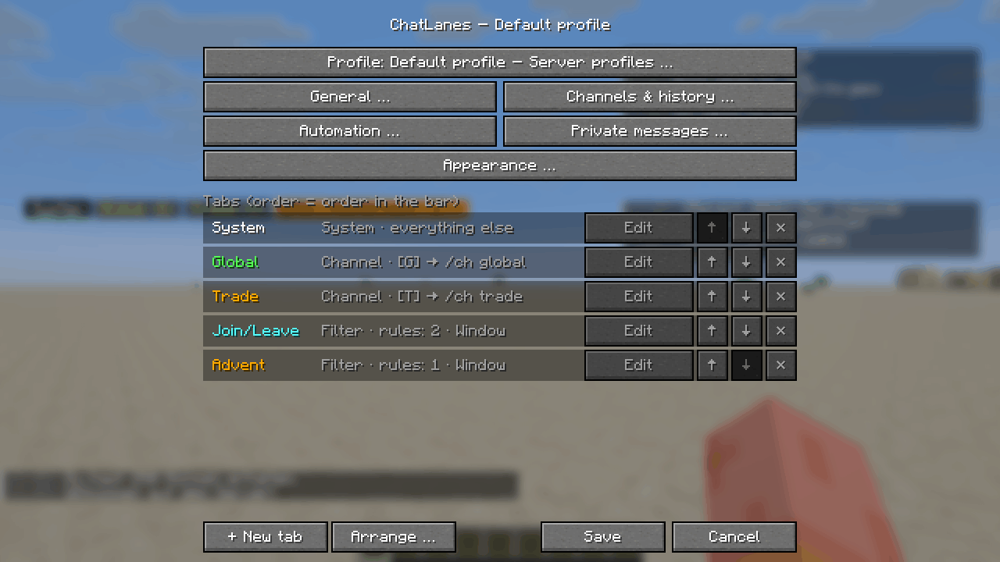
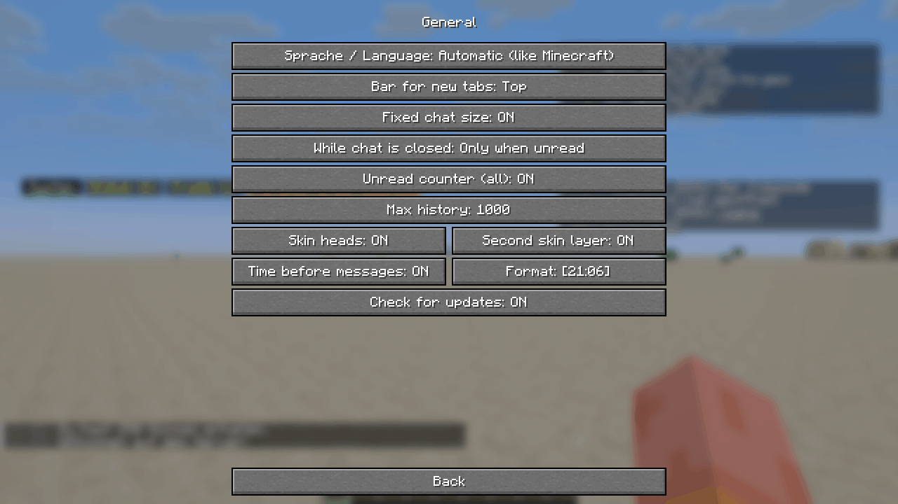
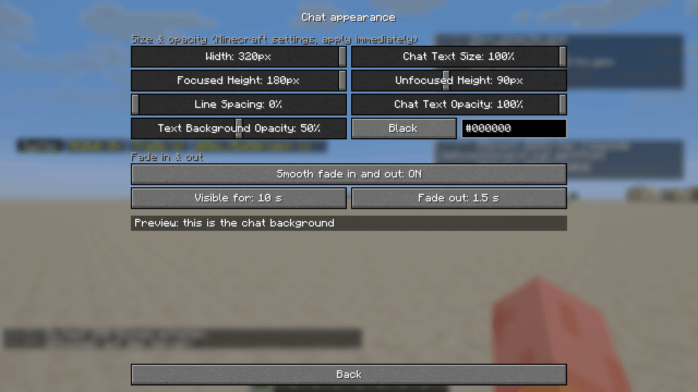
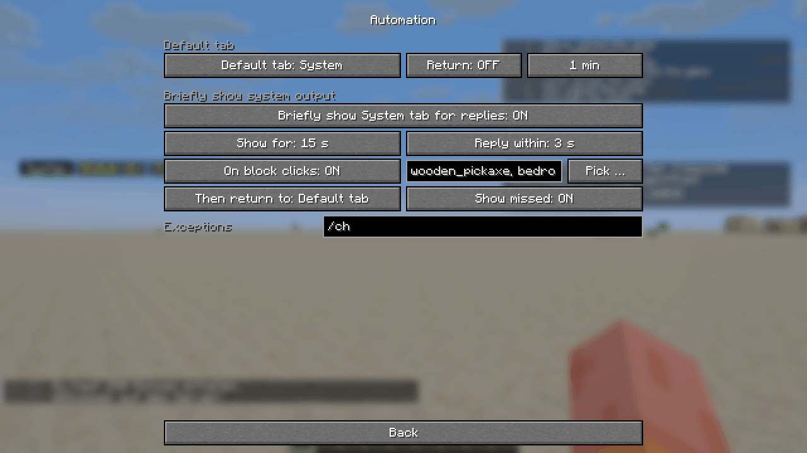
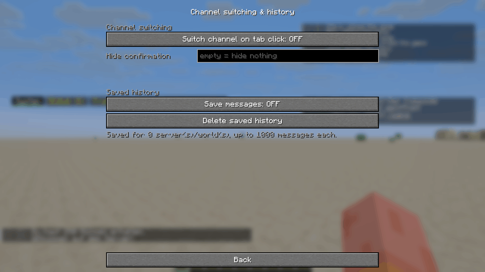

# Settings

🇩🇪 [Deutsche Version](Einstellungen)

Open with key **K**, `/chatlanes`, **“Settings”** in the tab bar or via Mod Menu. All settings apply to the **current server profile** (see [Server profiles](Server-profiles)) and only take effect after **Save**.

The tab list and the tab editor are explained on [Tabs and channels](Tabs-and-channels), windows on [Chat windows and filters](Chat-windows-and-filters) and PM tabs on [Private messages](Private-messages).

## General

| Setting | Meaning |
|---|---|
| **Sprache / Language** | *Automatic* (like Minecraft), *Deutsch* or *English*. Applies to all profiles. |
| **Bar for new tabs** | whether new tabs go to the top or bottom bar |
| **Fixed chat size** | while the chat is open the chat area always has its full height, so the tabs always stay in the same place |
| **While chat is closed** | whether the tab bar is shown *always*, *only when unread* or *never* while the chat is closed (per bar under *Arrange*) |
| **Unread counter (all)** | main switch for `(3)` after tab names (per tab under *Edit → Counter*) |
| **Max history** | how many messages are kept in total (vanilla: 100). All tabs share this storage. |
| **Skin heads** | skin head in front of the player name. Recognized are players who are online (or were during this session) and private messages. |
| **Second skin layer** | draw the head with the hat/helmet layer of the skin |
| **Time before messages** | e.g. `[14:05] [G] Player: Hi`. Applies to all tabs set to *Time: Default*. |
| **Format** | `[14:05]`, `[14:05:33]`, `14:05` or `14:05:33` |
| **Check for updates** | posts a chat message when a newer version is available on GitHub. Applies to all profiles. |

## Appearance

**Size & opacity:** width, height (focused), height (unfocused), chat text size, line spacing, chat text opacity and text background opacity. These are the normal Minecraft settings, available right in the menu, and they apply immediately.

**Background:** color of the chat background, either from presets (black, gray, blue, green, purple, red, brown, teal) or as your own hex value like `#1E3A5F`. The opacity comes from “Text Background Opacity”. A preview is shown at the bottom.

**Fade in & out:**
- **Smooth fade in and out:** new messages fade in softly and disappear slowly instead of abruptly while the chat is closed.
- **Visible for:** how long messages stay visible while the chat is closed.
- **Fade out:** how long fading out takes.

## Automation

### Default tab
- **Default tab:** this tab is selected every time you start the game. If you write there after logging in, the mod switches to its channel first.
- **Return / After:** switches back to the default tab automatically if you haven't written anything in the current tab for that long. This only happens while the chat is closed, so nothing jumps away while you're reading.

### Briefly show system output
If something lands in the System tab shortly after a command or block click, the view jumps there and back again afterwards. Your channel on the server stays the same. Handy e.g. for LogBlock lookups.

| Setting | Meaning |
|---|---|
| **Briefly show System tab for replies** | feature on or off |
| **Show for** | how long the view stays in the System tab. Further replies extend the time. |
| **Reply within** | only System messages arriving this soon after your action trigger it |
| **On block clicks** | clicks on blocks count as an action too |
| **Items / Pick …** | block clicks only count with these items in hand (e.g. `wooden_pickaxe, bedrock`). *Pick …* opens a list of all items to click. Empty = any item. |
| **Then return to** | *Default tab* or *Previous tab* |
| **Show missed** | after jumping back, messages that arrived in the tab in the meantime are shown again |
| **Exceptions** | commands that never jump to the System tab, e.g. `/ch`. Your tabs' switch commands and private messages are excluded automatically. |

## Channels & history

| Setting | Meaning |
|---|---|
| **Switch channel on tab click** | send the tab's switch command (e.g. `/ch global`) to the server when you select it |
| **Hide confirmation** | optional regular expression for the server's reply to the channel switch (e.g. `^You are now talking in`). Matching messages up to 3 seconds after a tab switch are hidden. |
| **Save messages** | saves the messages of all tabs per server and loads them back into the right tabs next time you join. A separator line shows where the saved history ends. |
| **Delete saved history** | deletes the saved messages of all servers (click twice). The currently visible chat stays. |

> If another mod also saves chat messages, old messages will appear twice. Turn off one of the two features.
