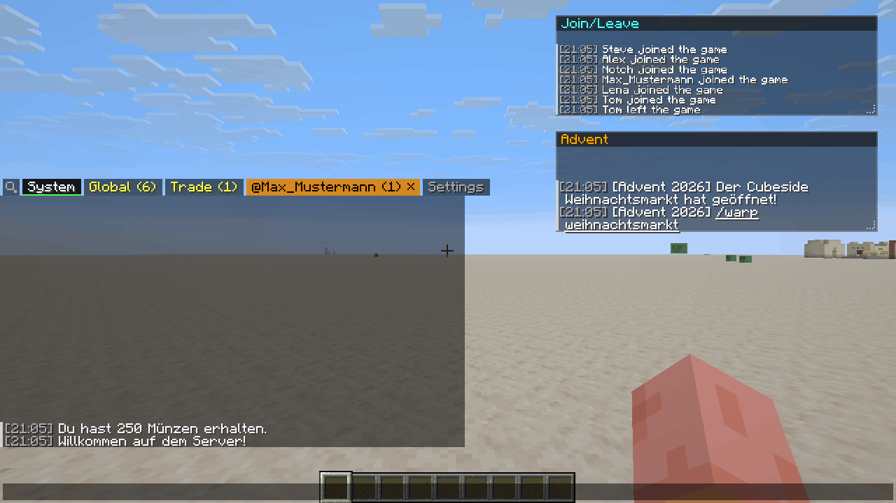
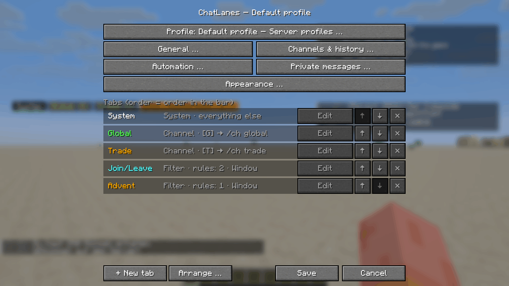
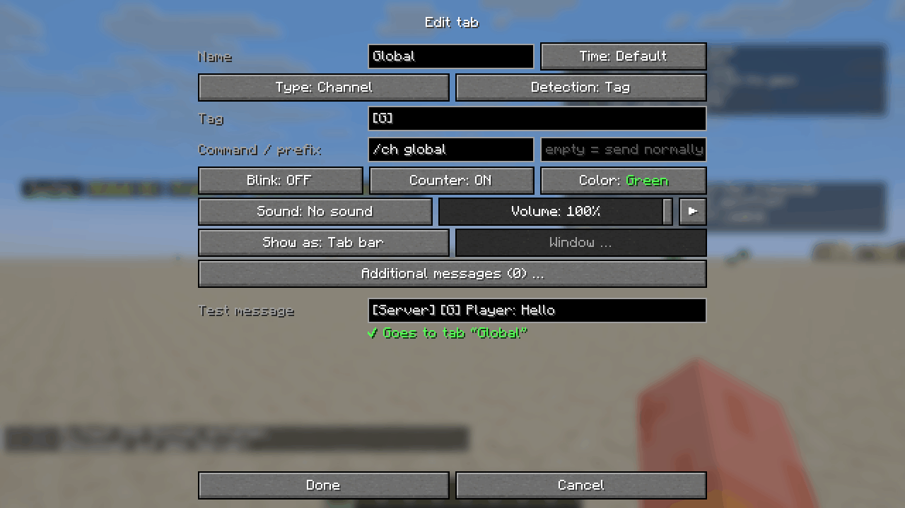
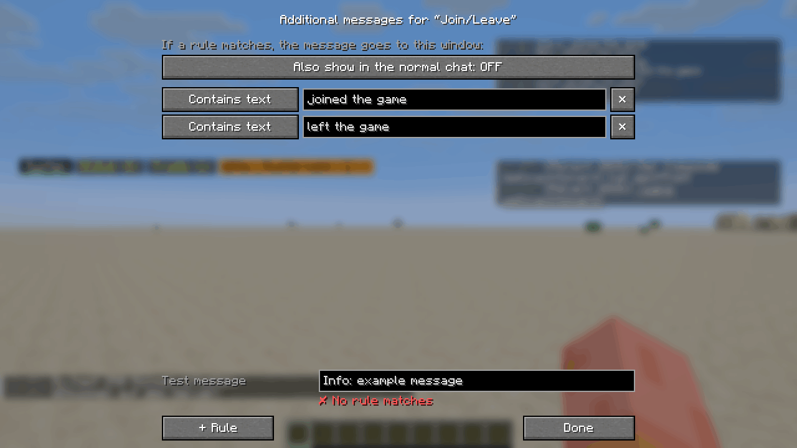
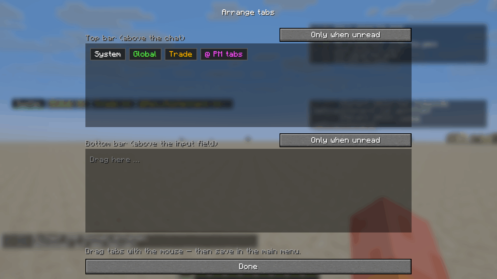

# Tabs and channels

🇩🇪 [Deutsche Version](Tabs-und-Kanaele)

ChatLanes splits the chat into **tabs**. Open the chat (**T**) and click a tab at the top to see only its messages.

## Tab types
| Type | Shows |
|---|---|
| **System** | everything no other tab matches (server notices, command output …) |
| **Channel** | messages that match the *detection*, e.g. everything starting with `[G]`. The first matching channel wins. |
| **All** | every message, like the normal Minecraft chat |
| **@Player** | created automatically for private messages, see [Private messages](Private-messages) |

By default there are **System**, **Global** (`[G]`) and **Trade** (`[T]`).

## Using the tab bar
- **Click** a tab to select it. If the tab has a *switch command* (e.g. `/ch global`), the mod also switches to that channel on the server, so you write there directly.
- **Unread messages:** tabs show `(count)` in yellow. Tabs with *Blink* flash orange.
- **Magnifier** at the front: [search the chat](Searching-the-chat) (also **Ctrl+F**).
- **Settings** at the end: open the settings.
- **Right-click a message:** create a filter, see [Chat windows and filters](Chat-windows-and-filters).
- While the chat is open, the chat area always has its full height so the tabs don't jump around (can be turned off under *General → Fixed chat size*).

## Managing tabs
The settings menu (key **K**) lists all tabs. The order of the list is the order in the bar.

- **+ New tab** adds a tab.
- **Edit** opens the tab editor (see below).
- **↑ / ↓** move the tab, **✕** deletes it.
- **Arrange …** opens the drag & drop view (see below).
- Changes only apply after **Save**.

## Editing a tab

| Field | Meaning |
|---|---|
| **Name** | text in the tab bar |
| **Time** | *Default* (as set under General), *ON* or *OFF* for this tab |
| **Type** | System, Channel or All |
| **Detection** | how messages for this channel are recognized (see below) |
| **Command / prefix** | *Switch command*: sent to the server when you select the tab, e.g. `/ch global`. *Send prefix*: put in front of every message you write in this tab, e.g. `/g `. Empty = nothing. Commands starting with `/` are never changed. |
| **Blink** | tab flashes while it has unread messages |
| **Counter** | show `(3)` after the name. OFF = the name just turns yellow. |
| **Color** | text color of the tab |
| **Sound / Volume / ▶** | sound for new messages (about 20 sounds to choose from), ▶ to preview. No sound while you're looking at the tab or for your own messages. |
| **Show as** | *Tab bar* or *Own window*, see [Chat windows and filters](Chat-windows-and-filters) |
| **Additional messages …** | custom rules (see below) |
| **Test message** | live test: type a chat line and instantly see whether it would go to this tab (✔ / ✘) |

### Detection types
| Type | Example | Explanation |
|---|---|---|
| **Tag** | `[G]` | The message starts with this tag. Server prefixes in front such as `[Freebuild]` are skipped. |
| **Contains text** | `auction` | The message contains the text anywhere (case-insensitive). |
| **Regex** | `^\[G\] ` | Regular expression on the text without colors. Invalid expressions are shown in red. |

## Additional messages
Use this to pull messages that would otherwise land in the **System tab** into a channel, e.g. every line containing “Info”.

- **+ Rule** adds a rule, **✕** deletes it.
- Rule types: *Tag*, *Contains text*, *Regex* and **Command output**.
- **Command output:** e.g. `/where`. Everything that would otherwise go to the System tab within the set time after this command (0.1 to 60 seconds) goes to this channel. Works with macro mods too.
- **Also show in System tab:** ON = the message appears in both tabs, OFF = it is moved.
- There is a live test at the bottom again.

## Arranging tabs (drag & drop)
In **Arrange …** you drag tabs with the mouse into the order you want and spread them over two bars:
- **Top bar**: above the chat
- **Bottom bar**: right above the input field

For each bar you choose what it does **while the chat is closed**: *Always show*, *Only when unread* (while a blinking tab in that bar has unread messages) or *Hide*. The PM tabs (`@ PM tabs`) can be moved too. Then **Save** in the main menu.

