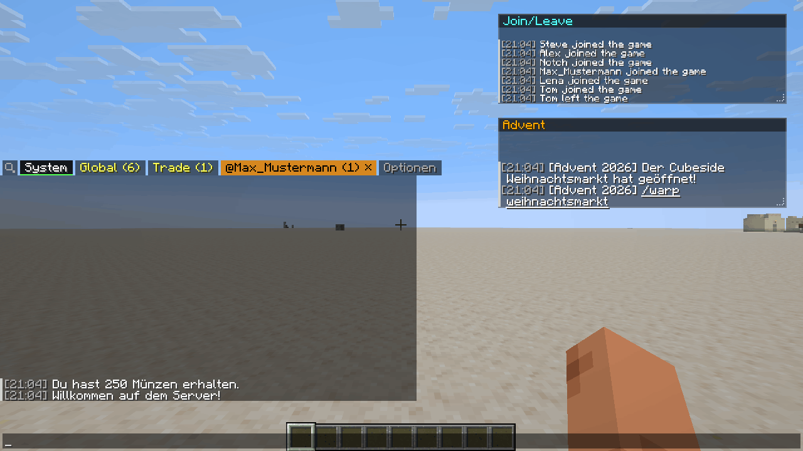
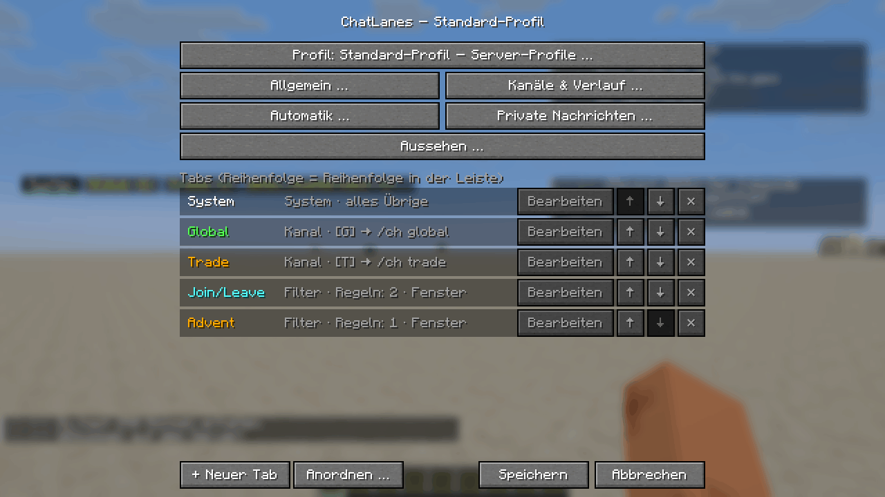
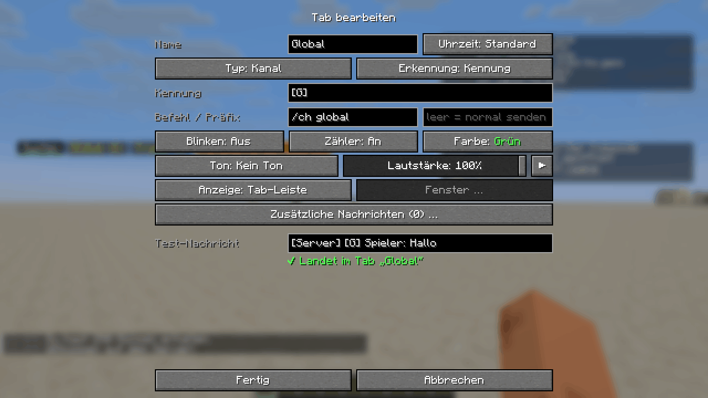
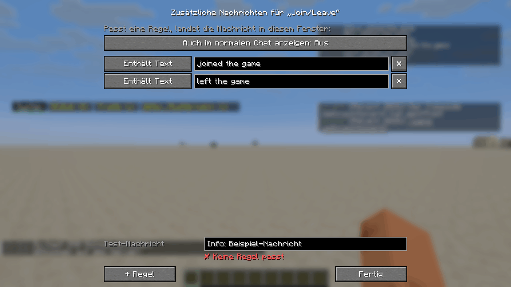
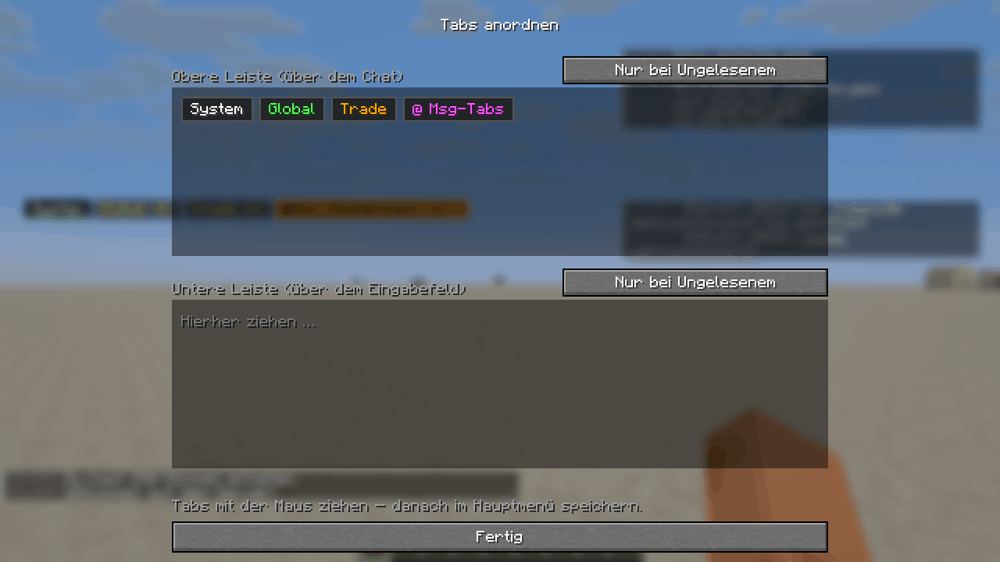

# Tabs und Kanäle

🇬🇧 [English version](Tabs-and-channels)

ChatLanes teilt den Chat in **Tabs** auf. Öffne den Chat (**T**) und klicke oben auf einen Tab, dann siehst du nur noch dessen Nachrichten.

## Die Tab-Arten
| Typ | Zeigt |
|---|---|
| **System** | alles, was in keinen anderen Tab passt (Server-Meldungen, Befehlsausgaben …) |
| **Kanal** | Nachrichten, die zur *Erkennung* passen, z. B. alles mit `[G]` am Anfang. Der erste passende Kanal gewinnt. |
| **Alle** | jede Nachricht, wie im normalen Minecraft-Chat |
| **@Spieler** | wird automatisch für private Nachrichten angelegt, siehe [Private Nachrichten](Private-Nachrichten) |

Standardmäßig gibt es **System**, **Global** (`[G]`) und **Trade** (`[T]`).

## Bedienung der Tab-Leiste
- **Klick** auf einen Tab: Tab auswählen. Hat der Tab einen *Wechsel-Befehl* (z. B. `/ch global`), wechselt die Mod auch auf dem Server in diesen Kanal, und du schreibst direkt dort.
- **Ungelesene Nachrichten:** Tabs zeigen `(Anzahl)` in Gelb. Tabs mit *Blinken* blinken orange.
- **Lupe** ganz vorne: [Chat durchsuchen](Chat-durchsuchen) (auch mit **Strg+F**).
- **Optionen** ganz hinten: Einstellungen öffnen.
- **Rechtsklick auf eine Nachricht:** Filter erstellen, siehe [Chatfenster und Filter](Chatfenster-und-Filter).
- Bei offenem Chat hat das Chatfeld immer die volle Höhe, damit die Tabs nicht springen (abschaltbar unter *Allgemein → Feste Chatgröße*).

## Tabs verwalten
Im Einstellungsmenü (Taste **K**) siehst du die Liste aller Tabs. Die Reihenfolge der Liste ist die Reihenfolge in der Leiste.

- **+ Neuer Tab** legt einen Tab an.
- **Bearbeiten** öffnet den Tab-Editor (siehe unten).
- **↑ / ↓** verschieben den Tab, **✕** löscht ihn.
- **Anordnen …** öffnet die Drag-&-Drop-Ansicht (siehe unten).
- Änderungen gelten erst nach **Speichern**.

## Tab bearbeiten

| Feld | Bedeutung |
|---|---|
| **Name** | Text in der Tab-Leiste |
| **Uhrzeit** | *Standard* (wie unter Allgemein), *An* oder *Aus* für diesen Tab |
| **Typ** | System, Kanal oder Alle |
| **Erkennung** | wie Nachrichten für diesen Kanal erkannt werden (siehe unten) |
| **Befehl / Präfix** | *Wechsel-Befehl*: wird beim Auswählen des Tabs an den Server gesendet, z. B. `/ch global`. *Sende-Präfix*: wird vor jede Nachricht gesetzt, die du in diesem Tab schreibst, z. B. `/g `. Leer = nichts. Befehle mit `/` bleiben immer unverändert. |
| **Blinken** | Tab blinkt, solange er ungelesene Nachrichten hat |
| **Zähler** | `(3)` hinter dem Namen anzeigen. Aus = nur der Name wird gelb. |
| **Farbe** | Textfarbe des Tabs |
| **Ton / Lautstärke / ▶** | Ton bei neuen Nachrichten (rund 20 Töne zur Auswahl), ▶ zum Probehören. Kein Ton, wenn du den Tab gerade ansiehst oder die Nachricht von dir ist. |
| **Anzeige** | *Tab-Leiste* oder *Eigenes Fenster*, siehe [Chatfenster und Filter](Chatfenster-und-Filter) |
| **Zusätzliche Nachrichten …** | eigene Regeln (siehe unten) |
| **Test-Nachricht** | Live-Test: tippe eine Chatzeile ein und sieh sofort, ob sie in diesem Tab landen würde (✔ / ✘) |

### Erkennungsarten
| Art | Beispiel | Erklärung |
|---|---|---|
| **Kennung** | `[G]` | Die Nachricht beginnt mit dieser Kennung. Server-Präfixe davor wie `[Freebuild]` werden übersprungen. |
| **Enthält Text** | `Auktion` | Die Nachricht enthält den Text irgendwo (Groß-/Kleinschreibung egal). |
| **Regex** | `^\[G\] ` | Regulärer Ausdruck auf den Text ohne Farben. Ungültige Ausdrücke werden rot angezeigt. |

## Zusätzliche Nachrichten
Damit holst du Nachrichten, die sonst im **System-Tab** landen würden, in einen Kanal, z. B. alle Zeilen mit „Info“.

- **+ Regel** fügt eine Regel hinzu, **✕** löscht sie.
- Regelarten: *Kennung*, *Enthält Text*, *Regex* und **Befehl-Ausgabe**.
- **Befehl-Ausgabe:** z. B. `/where`. Alles, was nach diesem Befehl innerhalb der eingestellten Zeit (0,1 bis 60 Sekunden) sonst im System-Tab landen würde, kommt in diesen Kanal. Das funktioniert auch mit Makro-Mods.
- **Trotzdem auch im System-Tab anzeigen:** An = die Nachricht erscheint in beiden Tabs, Aus = sie wird verschoben.
- Unten gibt es wieder einen Live-Test.

## Tabs anordnen (Drag & Drop)
Unter **Anordnen …** ziehst du Tabs mit der Maus in die gewünschte Reihenfolge und verteilst sie auf zwei Leisten:
- **Obere Leiste**: über dem Chat
- **Untere Leiste**: direkt über dem Eingabefeld

Pro Leiste stellst du ein, was sie **bei geschlossenem Chat** macht: *Immer anzeigen*, *Nur bei Ungelesenem* (solange ein blinkender Tab dieser Leiste ungelesene Nachrichten hat) oder *Ausblenden*. Auch die Msg-Tabs (`@ Msg-Tabs`) lassen sich verschieben. Danach im Hauptmenü **Speichern**.

